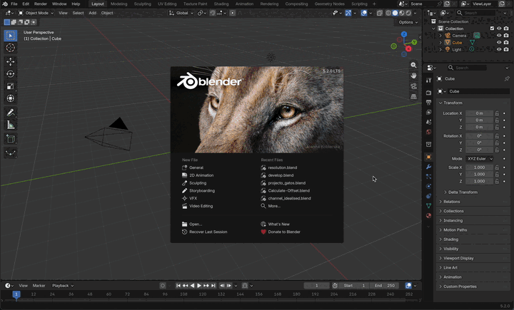
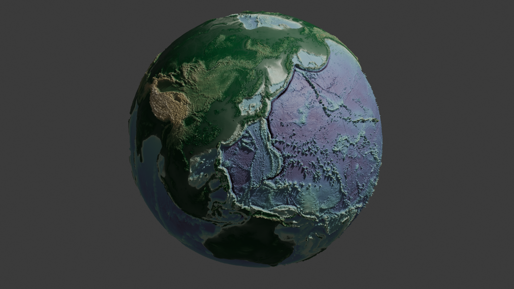
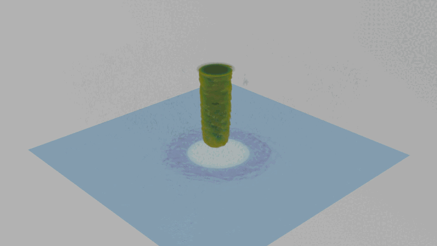

# BlenderNC

         

**BlenderNC** is an open source add-on and Python module to visualize **netCDF**, **grib**, and **zarr** datasets in [**Blender**](https://www.blender.org).

BlenderNC builds upon [**xarray**](https://github.com/pydata/xarray) and [**dask**](https://dask.org) to lazy load, manipulate, and display datasets as images in Blender.

#### Why BlenderNC?

Science visualization is a fundamental part of science communication and the exploration of large datasets. However, production quality real-time visualization and animation of scientific data has remained unreachable to the scientific community. BlenderNC main goal is to facilitate the generation of quality animations of scientific gridded data with a powerful and simple interface. For example:

- Quick load of datasets:

- Nodes tree for more complex visualizations, for example:

  - the Earth's topograhy

  

  - Or even a 4D visualization of an ocean eddy interacting with sea-ice:

  

Installation
------------

1. Download the zip for your operating system from the [latest release](https://github.com/blendernc/blendernc/releases/latest):
   - **Windows (64-bit):** `blendernc-<version>-windows_x64.zip`
   - **macOS (Apple Silicon, macOS 15 or newer):** `blendernc-<version>-macos_arm64.zip`
   - **Linux (64-bit):** `blendernc-<version>-linux_x64.zip`

   Each zip bundles the Python libraries BlenderNC needs for that platform, so pick the one that matches your system.
2. Drag and drop the zip into Blender, or go to `Edit > Preferences > Get Extensions`, open the drop-down menu in the top-right corner, choose `Install from Disk...` and select the zip.
3. Make sure BlenderNC is enabled in `Edit > Preferences > Add-ons`.

See the [installation guide](https://blendernc.readthedocs.io/en/latest/install.html) for more details.

Documentation
-------------

Learn more about BlenderNC in the official documentation at [https://blendernc.readthedocs.io](https://blendernc.readthedocs.io)

Contributing
------------

All contributions, bug reports, bug fixes, documentation improvements, enhancements, and ideas are welcome. More information about contributing to BlenderNC can be found at our [Contribution page](https://blendernc.readthedocs.io/en/latest/contribute.html).

Use Github to:
- report bugs,
- suggest features,
- provide examples,
- and view the source code.

Support
-------

**BlenderNC** is supported by:

To implement and improve support of weather and climate data visualizations in GRIB format and visualize numerical models of the global ocean and sea-ice.