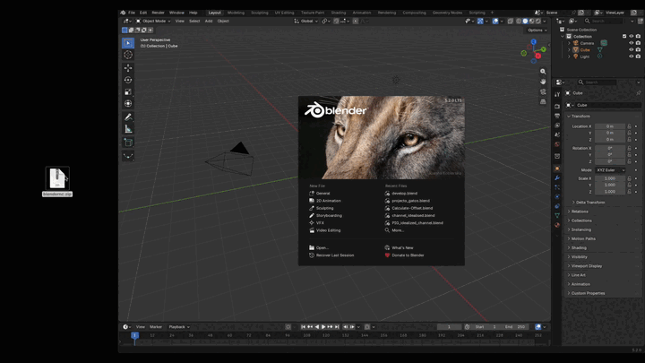

.. _install_blendernc:

=================
Install BlenderNC
=================

Installing BlenderNC is really simple:

- Download the zip (`click here`_):

.. _click here: https://github.com/blendernc/blendernc-zip-install/blob/master/blendernc.zip

- Drag and drop it into Blender:

You can also install it directly in Blender by going to `Edit > Preferences > Add-ons > Install` and selecting the downloaded zip file. After installation, make sure to enable the add-on by checking the box next to `BlenderNC`.

