.. _nodetree_guide:

###############
Node Tree Guide
###############

2D Datacubes
============

After the _quickstart_ guide, you will have a basic understanding of how to load and visualize datacubes in BlenderNC and introduced you to the BlenderNC node tree:

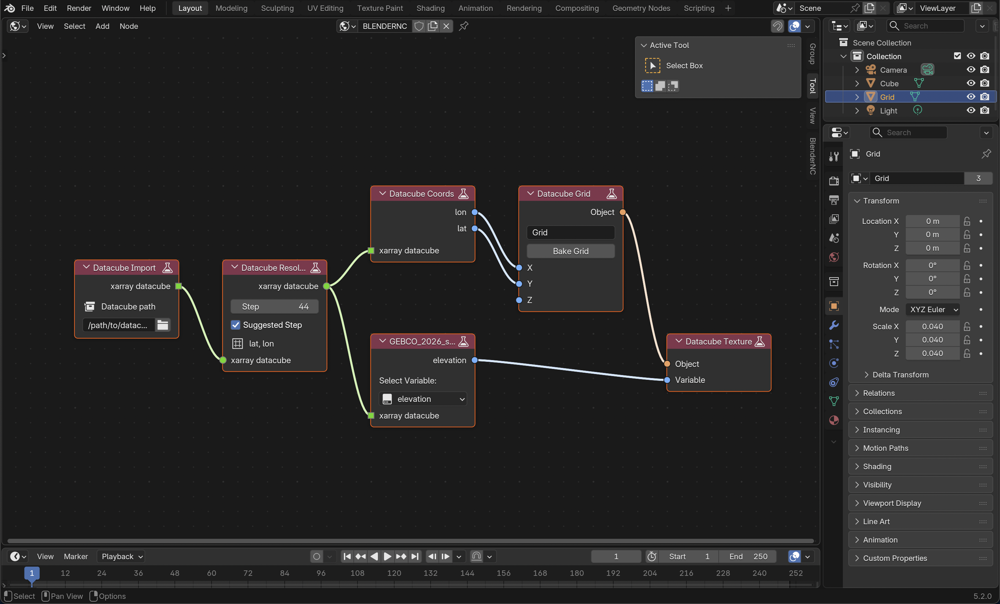

This guide will now help you understand how to customize, slice, select, and animate your datacubes using Blender's node system. Let's start in a new Blender project and navigate to BlenderNC node editor. Create a new node tree by clicking on `New` in the node editor header.

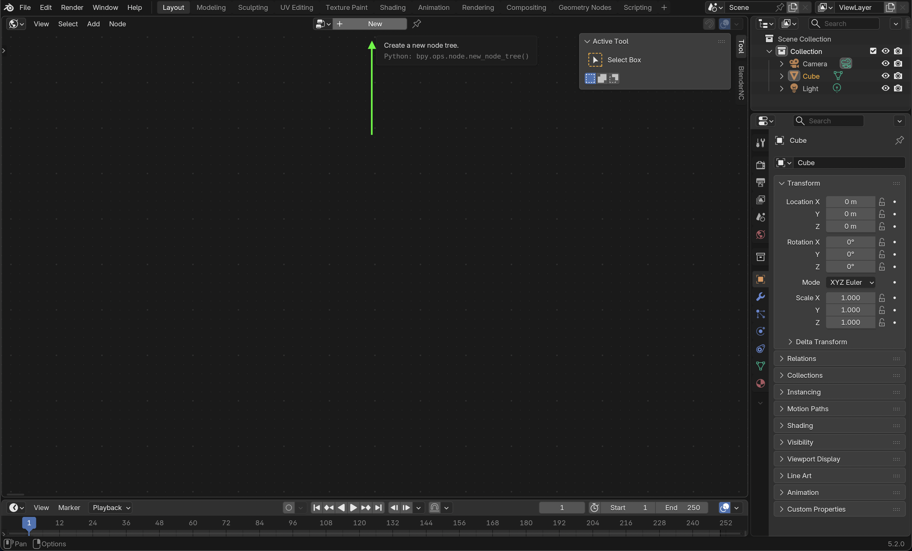

Let's start by understanding the main components of the BlenderNC node tree. By either clicking over the `Add` menu in the node editor or pressing `Shift + A`, you can add new nodes to the node tree.

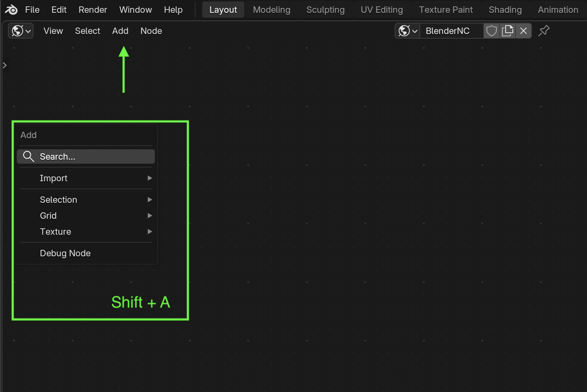

The nodes for this visualization are:

- **Datacube Import**: Loads the datacube and provides access to the datacube and thus its variables and coordinates. Found in the "Import" sub-menu.
- **Resolution**: Adjusts the resolution of the datacube grid. Found in the "Selection" sub-menu.
- **Datacube Variable**: Selects a variable of the datacube. Found in the "Import" sub-menu.
- **Datacube Coords**: Lists and makes available the coordinates of the datacube. Found in the "Grid" sub-menu.
- **Datacube Grid**: Creates the grid from the coordinates of the datacube. Found in the "Grid" sub-menu.

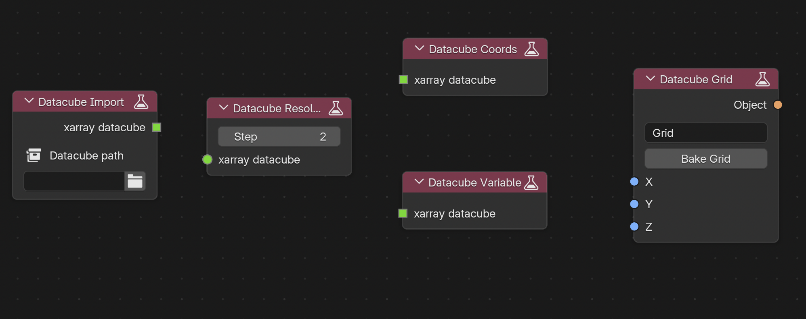

.. note::
    There are additional nodes for selection, subsampling, resolution, texture and volume. Feel free to explore them in the respective sub-menus: "Selection", "Grid", "Texture", and "Volume". An in depth explanation of these nodes will be provided in the following sections.

Let's download a sample datacube to work with. You can use any datacube of a surface (2D). For this guide, we will use the ETOPO dataset (~400 MB; `NOAA website <https://www.ngdc.noaa.gov/thredds/catalog/global/ETOPO2022/60s/60s_bed_elev_netcdf/catalog.html?dataset=globalDatasetScan/ETOPO2022/60s/60s_bed_elev_netcdf/ETOPO_2022_v1_60s_N90W180_bed.nc>`_,
or directly with `this link <https://www.ngdc.noaa.gov/thredds/fileServer/global/ETOPO2022/60s/60s_bed_elev_netcdf/ETOPO_2022_v1_60s_N90W180_bed.nc>`__). Save the file to a location accessible from Blender.

.. important::
    GEBCO is also compatible, but it requires a step of ~44 in the  `Resolution` node.

Click in the folder icon in the `Datacube Import` node to browse and select the downloaded ETOPO file. Once the file is selected, the datacube will be loaded.

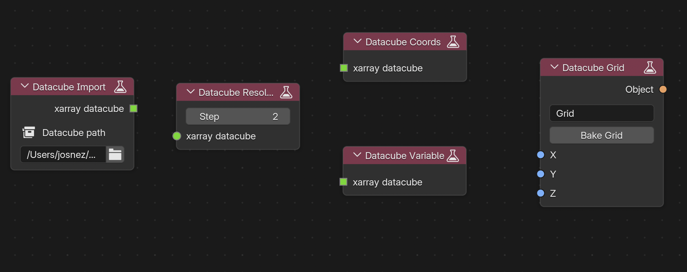

Unless an error was raised, the `Datacube Import` node now contains the loaded datacube. Let's proceed to connect it to the `Resolution` node. By default, BlenderNC adjusts the resolution step to force the smallest axes to be ≤ 1000 grid points. In this case, the dataset is sampled every 11 steps. You can change the step by deselecting `Suggested step`. Loading the full resolution may result in a very large grid, could impact performance, or even crash Blender.

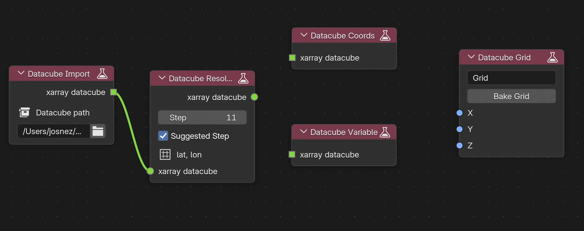

Now you can connect it to the `Datacube Variable` and `Datacube Coords` nodes, and you will have access to its variables and coordinates through these nodes.

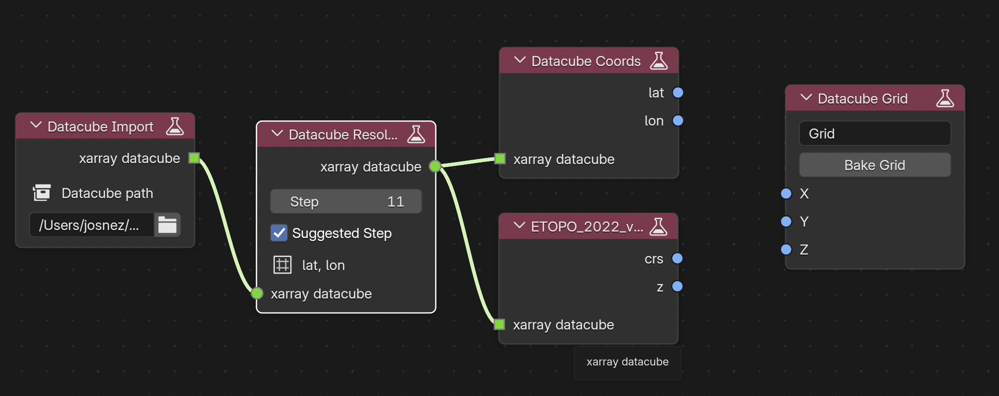

Now you can link the coordinates with the grid and bake the grid:

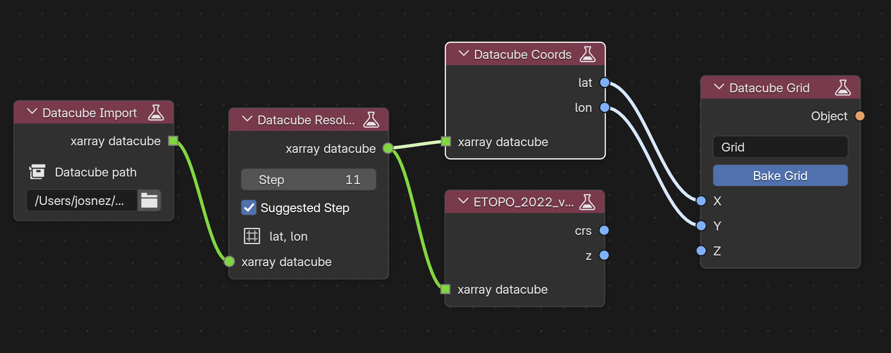

Once the grid is baked, you can render the scene or view it in the 3D Viewport. This has added a Grid object containing only the geometry (i.e. a plane) and the dimensions match those of the datacube, in this case -180 to 180 in longitude and -90 to 90 in latitude. Thus, we see the initial scene cube and a plane.

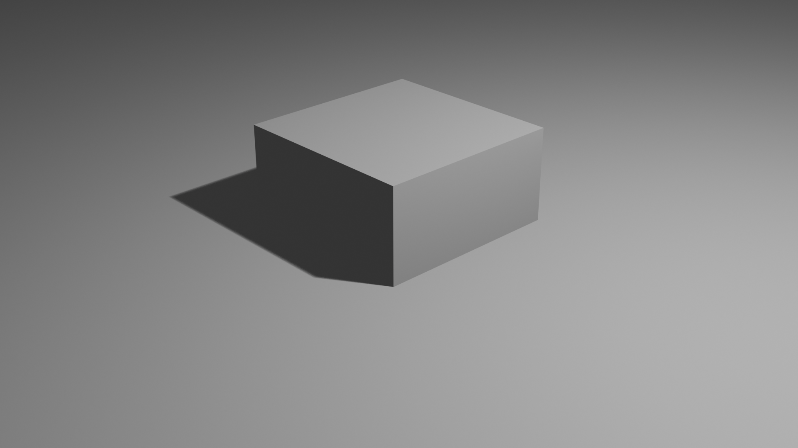

To visualize the actual data values, you will need to pass through the variable into the grid and re-bake the grid.

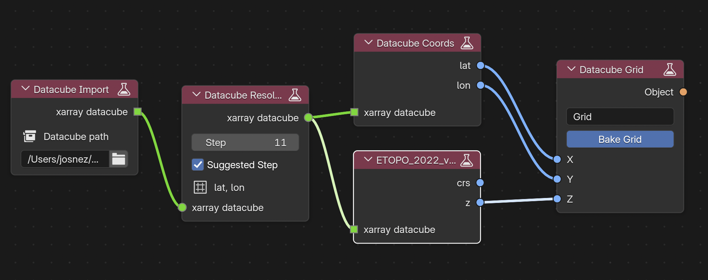

If you render the scene now, you won't see anything because the updated grid covers the camera view. You need to change the scale of the grid to fit within the camera view. (You can do this by selecting the Grid object and adjusting its scale in the Object Properties panel or pressing `S` to scale it interactively in the 3D Viewport.)

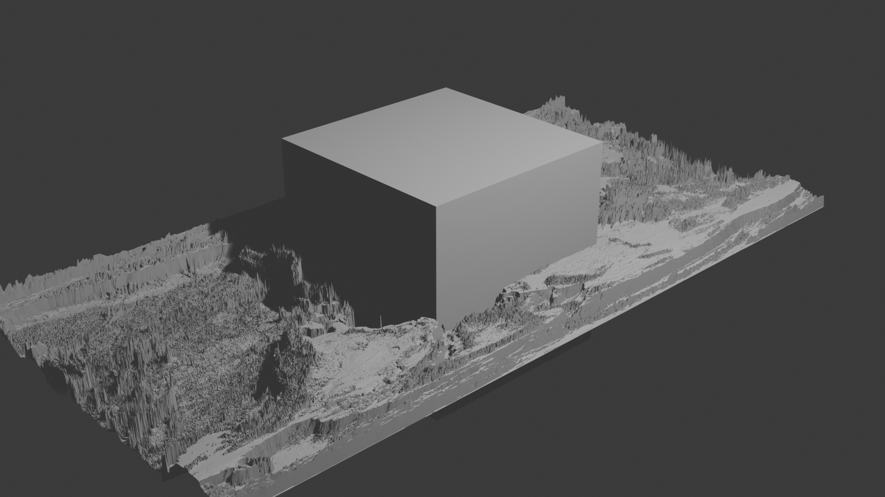

We can additionally, add now a `Datacube Texture` found in the "Texture" submenu, connect the `Datacube Variable` node and the object output from the grid to it and press `Apply Material`. `Datacube Texture` adds the selected variable as an attribute to the material, in fact, multiple `Datacube Texture` can be applied to the same object simultaneously.

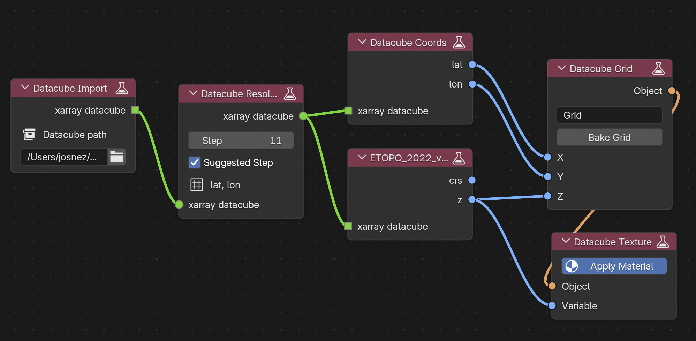

Rendering the scene with the applied material:

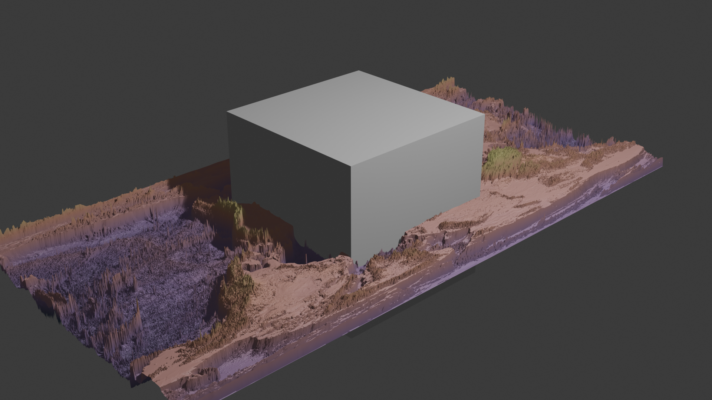

.. important::

    To save your blender project and keep your BlenderNC node tree, make sure to select the fake user for the BlenderNC node tree (next to the node tree name). This ensures that the node tree is not deleted when closing Blender.

So far, we have reproduced a similar result from that of the quick start guide, added to the geometry a variable from the datacube (z) and now directly interacting with BlenderNC nodes.

.. note::
    Note that these geographical coordinates allows us to turn the plane into a sphere by mapping the longitude and latitude to spherical coordinates. This can be done using the `Geometry Nodes` in Blender.

    .. image:: ../images/geometry_spherical_coords.png
      :width: 100%
      :alt: Geometry Spherical Coordinates

    The scaling applied before was necessary to fit the grid within the camera view, but when converting to spherical coordinates, you may need to adjust the scale to `1` for the sphere radius to match.

In the next sections, we will explore how to work with 3D datacubes, both in the form of (x, y, time) and (x, y, z), and how to visualize them effectively using BlenderNC nodes.

3D Datacubes (x, y, time)
=========================

Let's download a new dataset, for example, sea level data, which typically has dimensions (x, y, time). This will allow us to explore how to work with 3D datacubes in the form of (x, y, time). The data is hosted by `Copernicus`, but you will need to create an account with `ECMWF <https://www.ecmwf.int>`__. After creating your account and log in, download the desired dataset from:

 `<https://cds.climate.copernicus.eu/datasets/satellite-sea-level-global?tab=download>`__.

In this guide, we are using the daily sea level data of 2025 (~3 Gb).

Let's create a new BlenderNC node tree and add the nodes:

- **Datacube Import**: Loads the datacube and provides access to the datacube and thus its variables and coordinates. Found in the "Import" sub-menu.
- **Datacube Variable**: Selects a variable of the datacube. Found in the "Import" sub-menu.
- **Datacube Coords**: Lists and makes available the coordinates of the datacube. Found in the "Grid" sub-menu.
- **Datacube Grid**: Creates the grid from the coordinates of the datacube. Found in the "Grid" sub-menu.
- **Datacube Animate Texture**: Creates an animated texture based on the datacube coordinates (third dimension, in this case time, is animated). Found in the "Grid" sub-menu.

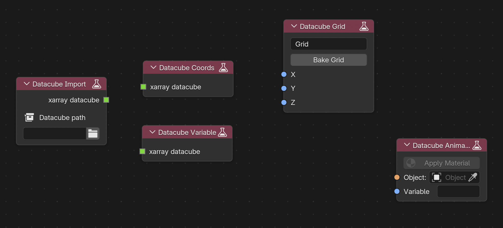

Select the datasets you downloaded using the **Datacube Import** node. This dataset is stored one day per file, within the ``Blender File View`` you can select multiple files at the same time to import them all.

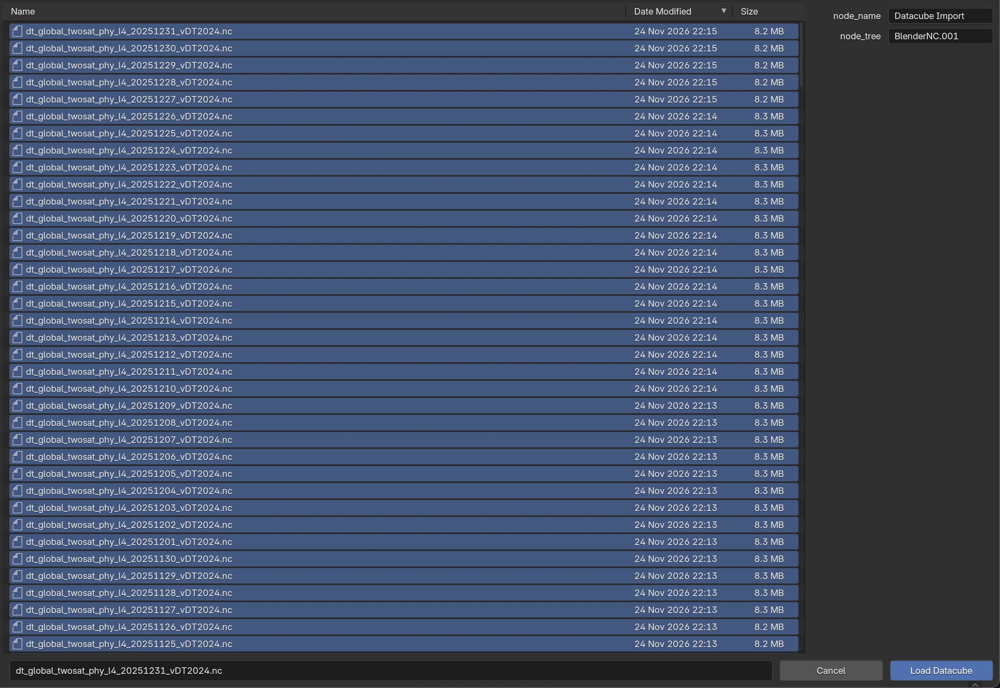

Once the files are imported, you can proceed to select the variable (e.g., adt, absolute dynamic topography) and coordinates for visualization using the **Datacube Variable** and **Datacube Coords** nodes. Link the **Datacube Coords** node to the **Datacube Grid** node to create the grid for visualization.

.. important::
    Make sure you change the object name to something meaningful, we will call it `ADT`. Otherwise, your previous object will be overwritten.

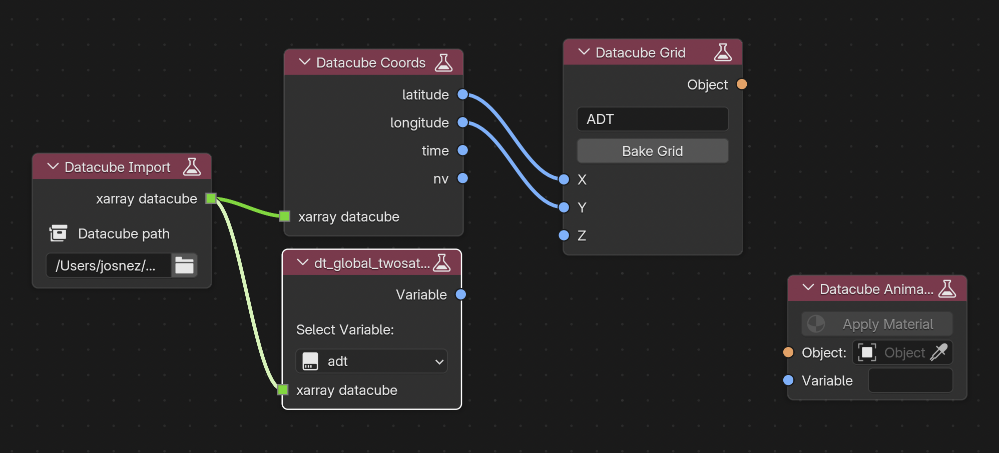

If you render the scene at this point, you will see the ETOPO topography globe alongside a plane (the grid of the current variable).

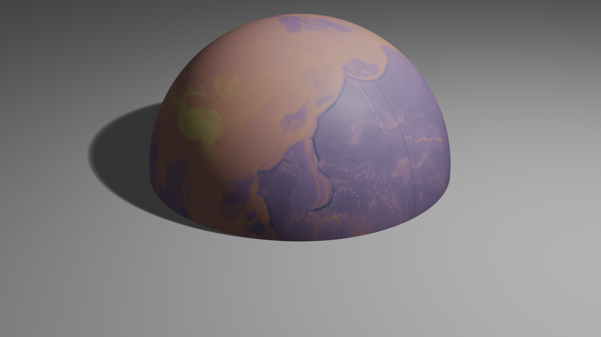

We can now proceed to connect the object from the **Datacube Grid** node  and the Variable from the **Datacube Variable** node to the **Datacube Animate Texture** node to animate the variable over time. Similarly to the `Datacube Texture`, the `Datacube Animate Texture` node adds the variable as an attribute of the object, which is then updated each time the frame changes.
Apply the Material to the object to visualize the animated texture.

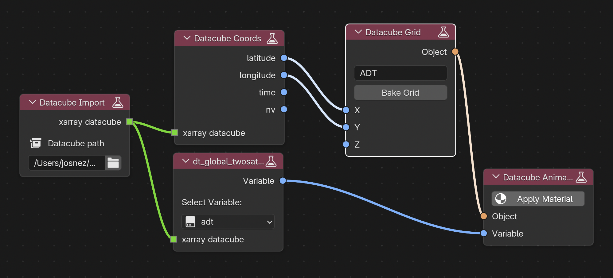

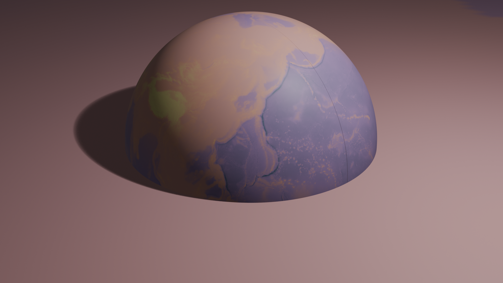

Let's apply the same modifier to make the plane a sphere as before. Rendering it now, looks strange because both the ETOPO topography globe and the variable plane are visible simultaneously.

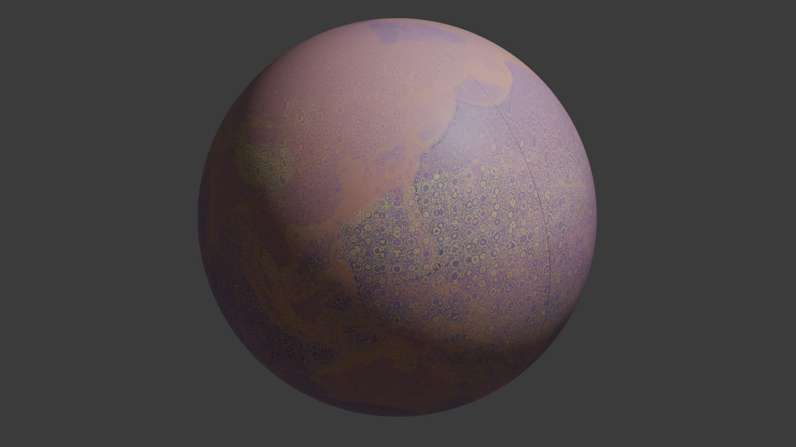

But now we can go to the material editor and geometry node to have a different colormap for each variable (``topo`` for ETOPO `z` and ``amp`` for `adt``) and affecting the sphere geometry to include the topography in the radial component. We can now visualize the ETOPO topography and ADT correctly on the sphere.

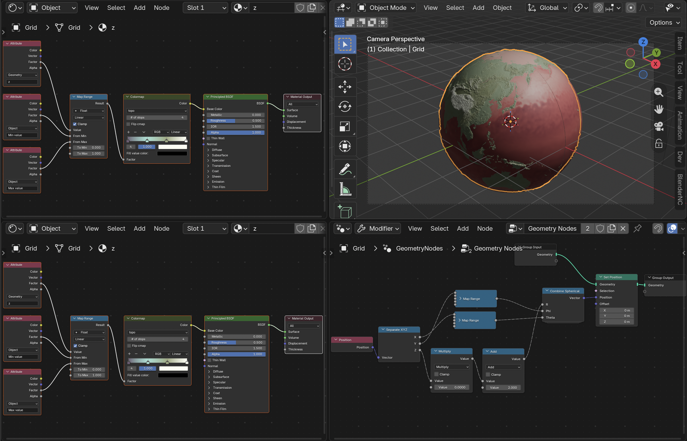

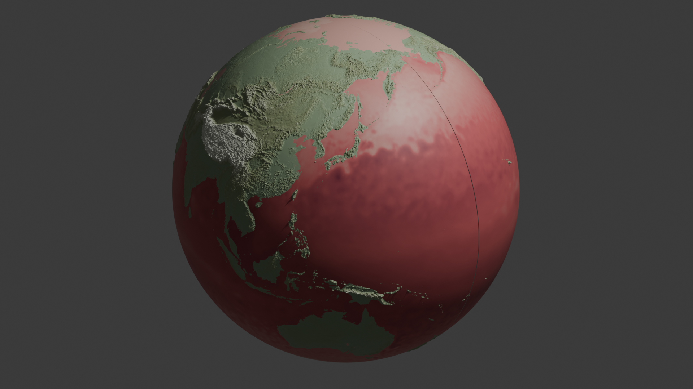

Of course, you can further customize the visualization by adjusting the material properties, colormaps, and geometry nodes to better represent the data and achieve the desired visual effect.

This is a 3D visualization of the datacube, where the spatial dimensions (x, y) are represented in the 3D space, and the third dimension (time) is associated with the frame in the ``Timeline``. By pressing ``space`` in your keyboard, you can play the animation and observe how the variable evolves over time. Below is the rendered animation of the `adt` variable:

3D Datacubes (x, y, z)
======================

WIP

4D Datacubes (x, y, z, time)
============================

WIP

Unstructured grids
==================

WIP

.. note::
    Using the ``Select Index`` node allows you to select specific indices from the datacube, which is particularly useful to change a 4D datacube into a 3D datacube and use either of the previous visualization techniques for 3D datacubes.