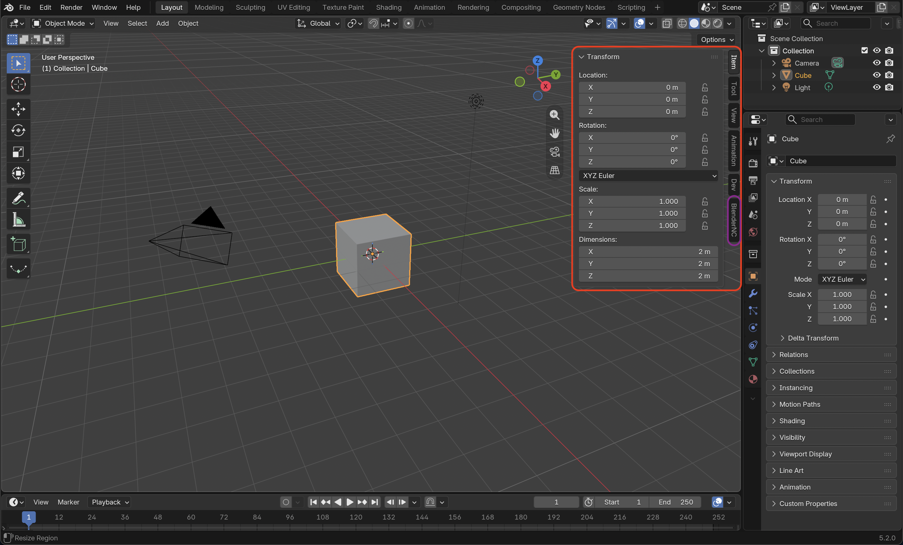
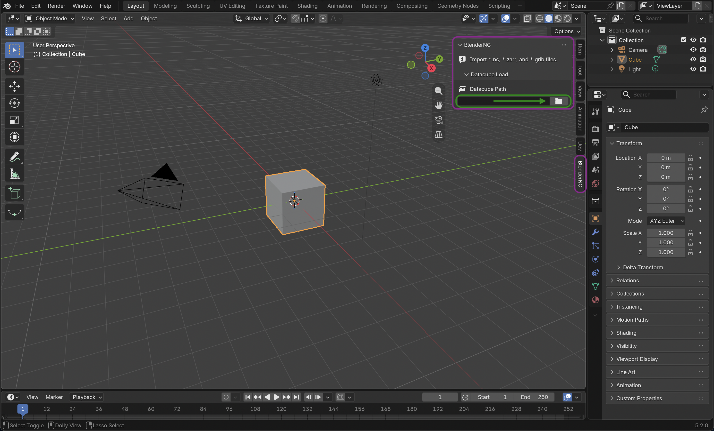
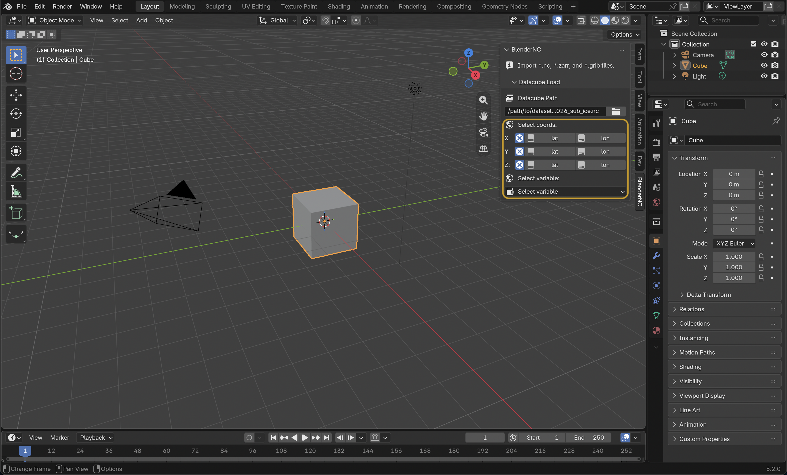
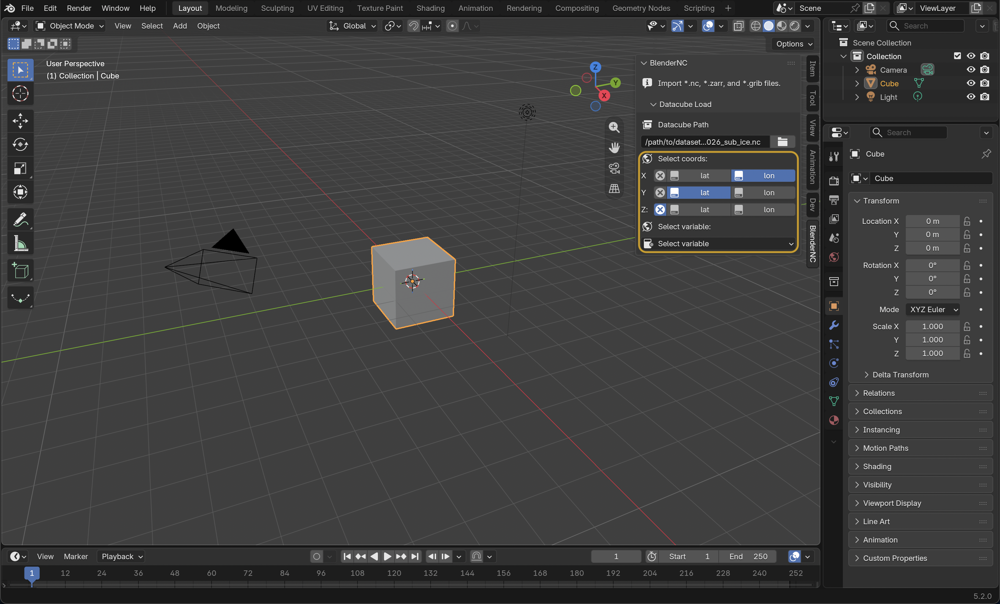
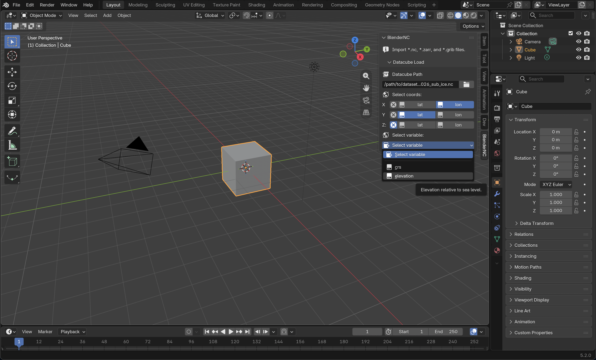
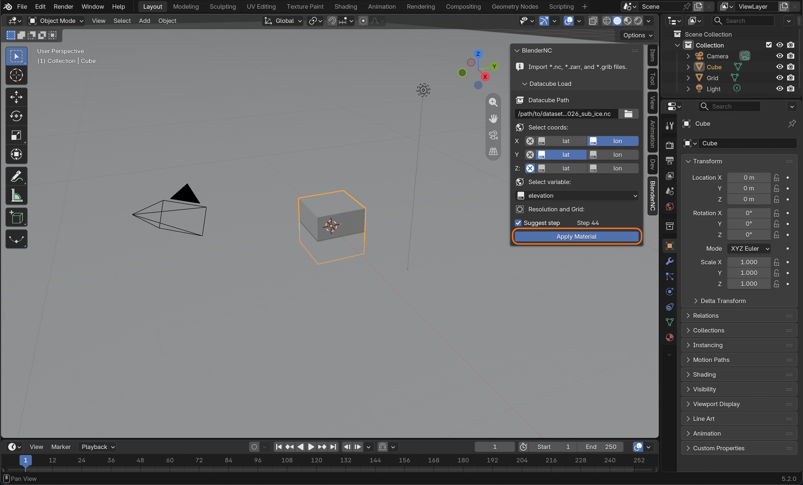
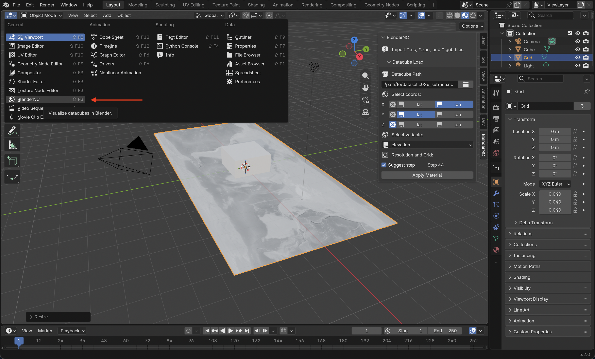
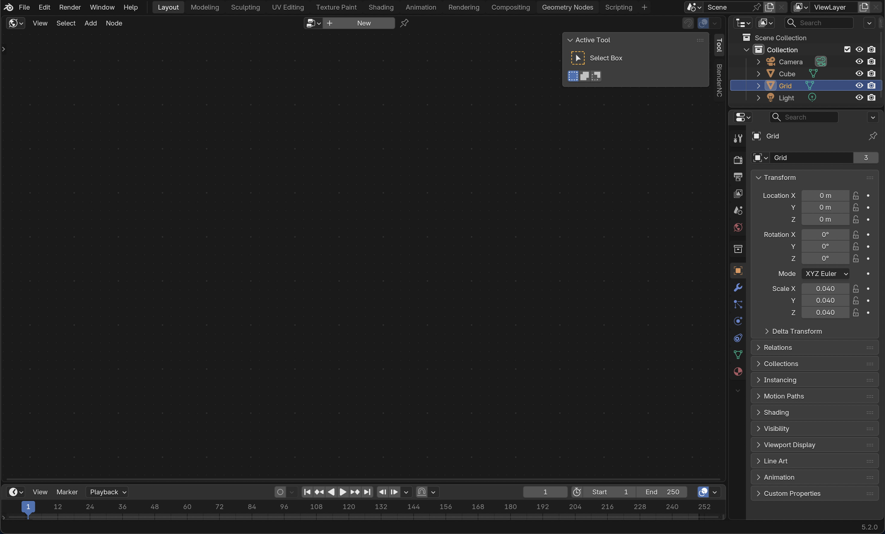
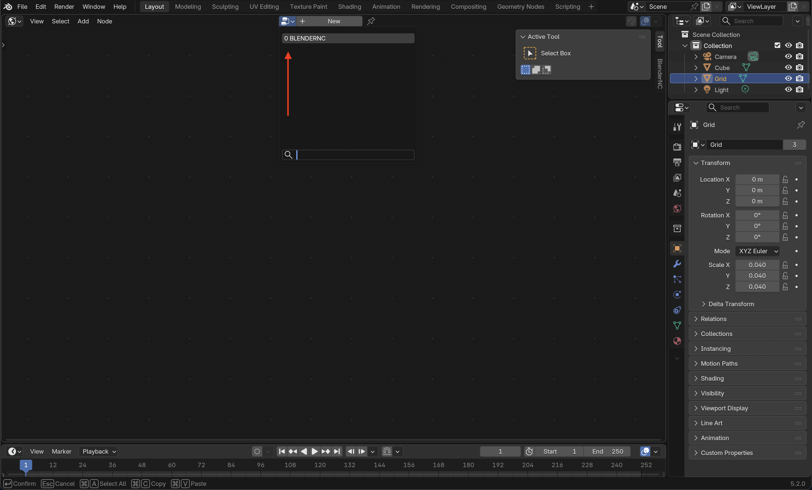
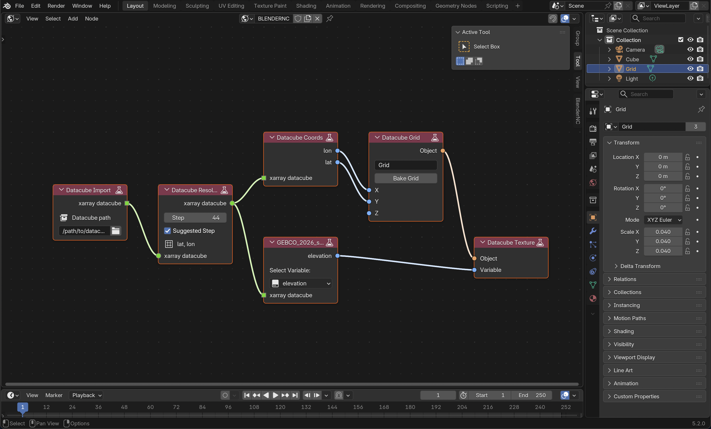

.. _quickstart_guide:

Quickstart Guide
################

.. raw:: html

    

.. |xcircled| unicode:: U+24CD

.. role:: red

.. role:: purple

.. role:: green

.. role:: orange

.. role:: teal

.. role:: blue

This guide will help you with the introductory steps to import datacubes and to visualize them. This is intended for first-time users of BlenderNC and visualization of 2D fields (e.g. bathymetry).

Let's start by downloading the GEBCO bathymetry dataset. You can find it at `GEBCO official website <https://www.gebco.net/>`_ or download it directly by clicking `here <https://dap.ceda.ac.uk/bodc/gebco/global/gebco_2026/sub_ice_topography_bathymetry/netcdf/GEBCO_2026_sub_ice.zip?download=1>`__ (it is approximately 7 Gb uncompressed)!

Open Blender (>5.2) and in the 3D view pressing "n" to open the :red:`sidebar`. Switch to the :purple:`BlenderNC panel`.

Within the :purple:`BlenderNC panel` click on `Load datacube`, then select a
datacube by clicking the :green:`folder icon`.

Navegate in the file browser to locate your downloaded GEBCO bathymetry dataset.
:teal:`Select` the dataset and click in :teal:`Load Datacube`.

.. image:: ../images/blendernc_import.png
  :width: 100%
  :alt: BlenderNC search

Select the coordinates to create the surface corresponding to the visualization you want to achieve. In this case, we want to visualize the topography, and thus we will select:

- X = lon,
- Y = lat,
- Z = |xcircled| (None).

After selecting the coordinates, it should look like this:

Now, let's select a variable to visualize. In this case, it will be `elevation`.

After clicking the variable, BlenderNC will create a `Grid` object using the coordinates you have selected. This object contains the variable you have chosen (as an attribute of the object), but it will not be visible until you apply the material.

.. important::
  By default, the resolution of the grid is optimized for performance, meaning that grids with a dimension larger than 1000 will be downsampled to 1000.
  In the case of the GEBCO bathymetry dataset, the downsampling to approximately 1000 points translates into sampling the dataset every 44 steps.
  You can adjust this setting by unlocking the resolution limit by unchecking the `Suggested step`. However this may impact performance if the dataset is very large or even crash Blender.

.. image:: ../images/blendernc_selected_variable.png
  :width: 100%
  :alt: BlenderNC select variable

Now that you have selected the variable, you can :orange:`Apply Material` to visualize it.

Although the material has been applied, the object will still not show it in the 3D view if the viewport shading is not set to display materials. To make it visible, switch the viewport shading to :blue:`Material Preview` or :blue:`Rendered`. This can be achieved by clicking choosing either option in the top right corner of the 3D view or pressing `z`, the shortcut key, to chose the shading mode.

.. image:: ../images/blendernc_material_preview.png
  :width: 100%
  :alt: BlenderNC material preview

.. note::
  By default, ``Apply Material`` will create and assign a material to the Grid object using the selected variable. You can further customize this material in the Shader Editor if needed:

  .. image:: ../images/blendernc_shader_editor.png
    :width: 100%
    :alt: BlenderNC Shader Editor

BlenderNC does not automatically scales the grid to fit in the camera view, it preserves the coordinates. In other words, you may need to manually adjust the scale of the Grid object to make it fit in the camera view.

To make the Grid object fit in the camera view, select the object, press the shortcut `S` to scale, and adjust it until it is properly framed in the viewport.

.. image:: ../images/blendernc_scale.png
  :width: 100%
  :alt: BlenderNC object scaled

So far, you have learned how to select coordinates, choose a variable, apply the material, and adjust the scale of the Grid object to fit in the camera view. However, BlenderNC builds upon nodes, which are the foundation to creating, visualizing, and animating datacubes in Blender.
In the next section (:ref:`in_depth_guide`), you will learn the backbone of BlenderNC, including how to manipulate nodes and create more advanced visualizations. To access the node editor that just created this simple visualization, you need to switch to the BlenderNC node editor on the top left corner of the workspace.

The BlenderNC node editor is similar to the Geometry Node Editor in Blender, but it is specifically designed for visualizing and manipulating datacubes.

Now that you are in the node editor, you can select the default node ``BlenderNC`` tree created for the Grid object.

Now that you have selected the BlenderNC node tree, you can see and start manipulating it to create more advanced visualizations of your datacube.

