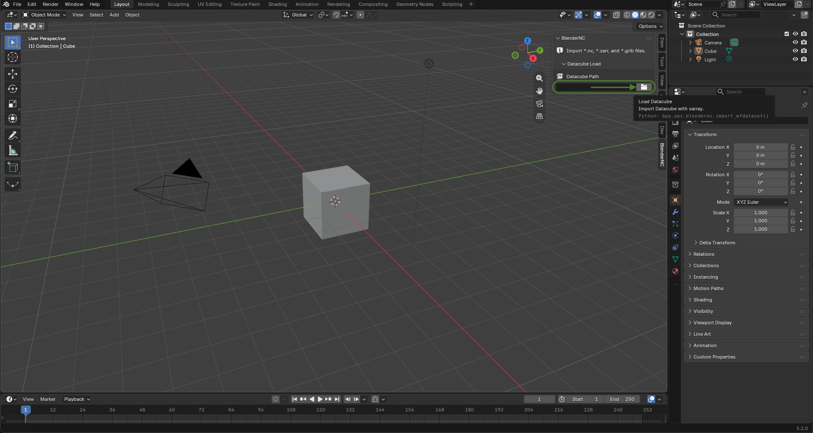
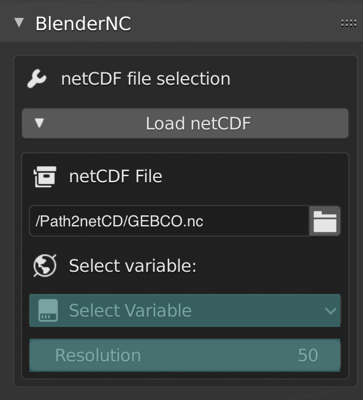
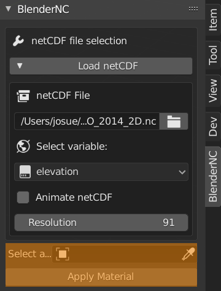
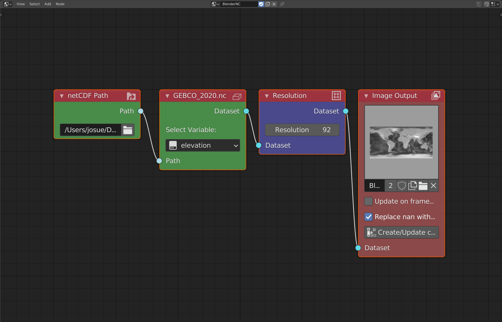

.. _quickstart_guide:

Quickstart Guide
################

.. raw:: html

    

.. role:: red

.. role:: purple

.. role:: green

.. role:: orange

.. role:: teal

This guide will help you with the introductory steps to import datacubes and to visualize them. This is intended for first-time users of BlenderNC and visualization of 2D fields (e.g. bathymetry).

Let's start by downloading the GEBCO bathymetry dataset. You can find it at `GEBCO official website <https://www.gebco.net/>`_ or download it directly by clicking `here <https://dap.ceda.ac.uk/bodc/gebco/global/gebco_2026/sub_ice_topography_bathymetry/netcdf/GEBCO_2026_sub_ice.zip?download=1>`__ (it is approximately 7 Gb uncompressed)!

Open Blender (>5.2) and in the 3D view pressing "n" to open the :red:`sidebar`.

.. image:: ../images/3D_view.png
  :width: 100%
  :alt: Blender 3D view

Switch to the :purple:`BlenderNC panel`.

.. image:: ../images/BlenderNC_panel.png
  :width: 100%
  :alt: BlenderNC panel

Within the :purple:`BlenderNC panel` click on `Load datacube`, then select a
datacube by clicking the :green:`folder icon`.

Navegate in the file browser to locate your downloaded GEBCO bathymetry dataset.
:teal:`Select` the dataset and click in :teal:`Load Datacube`.

Select an object and apply the material by clicking
:orange:`Apply Material`.

To animate the datacube in time click over "**Animate datacube**". Press **space**
in your keyboard to visualize animation.

.. note:: The material will be applied to the selected object.

The `Beginner mode` creates the basic nodes in the BlenderNC Editor. To access it,
divide the workspace and select **BlenderNC** node editor:

Now you are ready to become a PRO!
