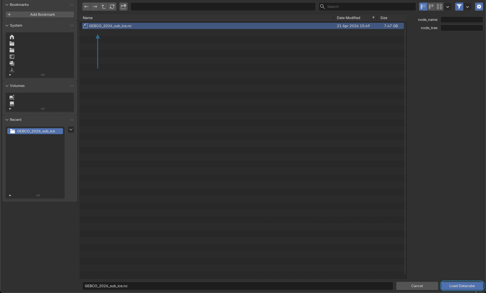
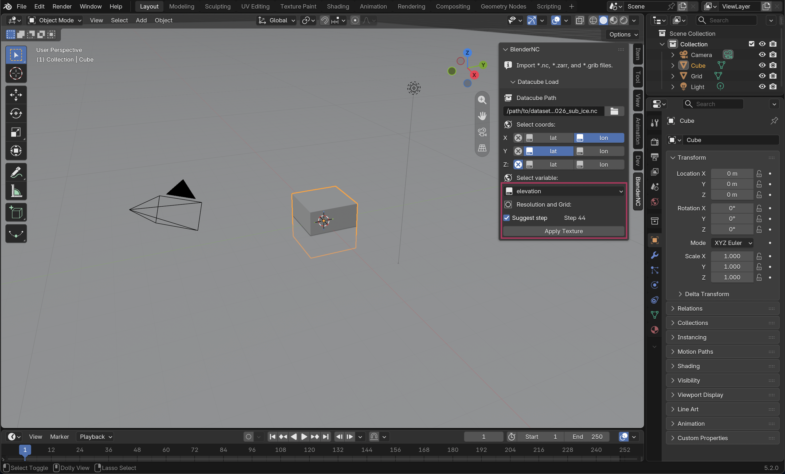
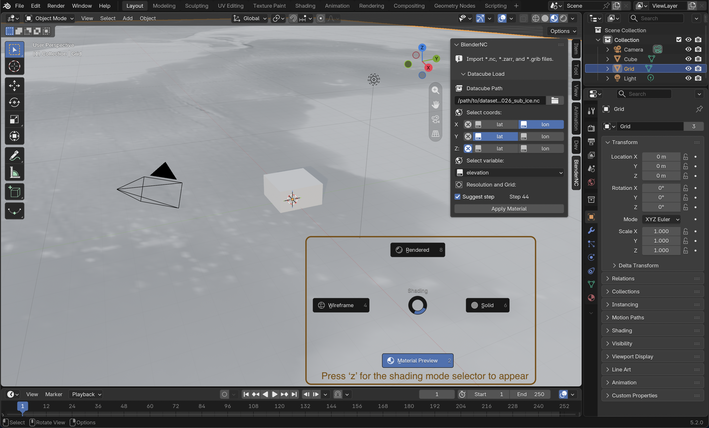
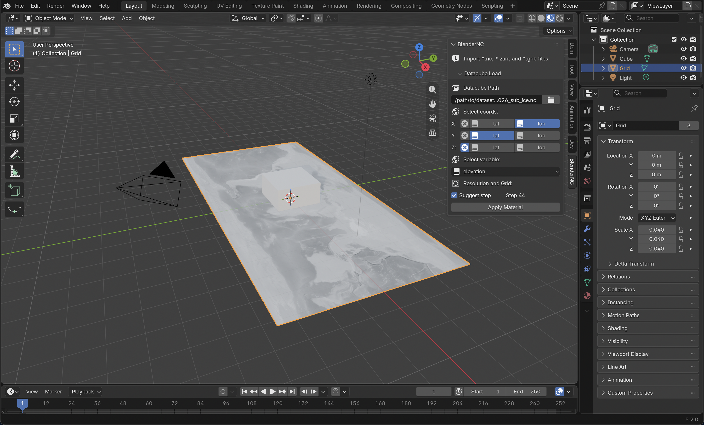

.. _quickstart_guide:

Quickstart Guide
################

.. raw:: html

    

.. |xcircled| unicode:: U+24CD

.. role:: red

.. role:: purple

.. role:: green

.. role:: orange

.. role:: teal

.. role:: blue

This guide is for first-time users. It shows how to load a datacube and display
a 2D field, using the GEBCO bathymetry as an example.

1. Download the data
====================

Download the GEBCO bathymetry from the `GEBCO website <https://www.gebco.net/>`_,
or directly with `this link <https://dap.ceda.ac.uk/bodc/gebco/global/gebco_2026/sub_ice_topography_bathymetry/netcdf/GEBCO_2026_sub_ice.zip?download=1>`__.
Unzip it; the file is about 7 GB.

2. Open the BlenderNC panel
===========================

Open Blender (5.2 or newer). In the 3D view, press ``N`` to open the
:red:`sidebar`, then click the :purple:`BlenderNC panel`.

.. image:: ../images/3D_view.png
  :width: 100%
  :alt: Blender 3D view

3. Load the datacube
====================

In the :purple:`BlenderNC panel`, click ``Load datacube``, then click the
:green:`folder icon`.

.. image:: ../images/blendernc_panel_path.png
  :width: 100%
  :alt: BlenderNC search

In the file browser, find the GEBCO file, :teal:`select` it, and click
:teal:`Load Datacube`.

4. Choose the coordinates
=========================

The coordinates set the shape of the surface. For a map of the topography,
choose:

- X = lon
- Y = lat
- Z = |xcircled| (none)

.. image:: ../images/blendernc_select_coords.png
  :width: 100%
  :alt: BlenderNC select

The panel should now look like this:

.. image:: ../images/blendernc_selected_coords.png
  :width: 100%
  :alt: BlenderNC selected

5. Choose the variable
======================

Choose the variable to show: ``elevation``.

.. image:: ../images/blendernc_select_variable.png
  :width: 100%
  :alt: BlenderNC select variable

BlenderNC creates a ``Grid`` object from the coordinates and stores the
variable on it. The grid stays invisible until you apply a material (step 6).

.. note::
  The resolution and material options only appear once both the variable and
  at least two coordinates are chosen.

.. important::
  To keep Blender responsive, BlenderNC suggests a step that reduces the
  shorter side of the grid to about 1000 points. The same step is used for
  both sides. For GEBCO, this means keeping one point every 44.

  To pick your own step, untick ``Suggest step``. The step starts at the
  suggested value, so you can lower it gradually. A small step on a large
  dataset can make Blender very slow or crash it.

6. Apply the material
=====================

Click :orange:`Apply Material`.

.. image:: ../images/blendernc_apply_material.png
  :width: 100%
  :alt: BlenderNC apply material

The material only shows when the viewport displays materials. Switch the
viewport shading to :blue:`Material Preview` or :blue:`Rendered`, using the
buttons in the top right corner of the 3D view or by pressing ``Z``.

.. note::
  ``Apply Material`` creates a material for the selected variable and assigns
  it to the Grid object; clicking it again reuses both. When you pick another
  variable, the grid keeps its shape and takes that variable's material, if
  you applied one before. The same button sits on the **Datacube Texture**
  node in the node editor. You can edit the material in the Shader Editor:

  .. image:: ../images/blendernc_shader_editor.png
    :width: 100%
    :alt: BlenderNC Shader Editor

7. Scale the grid
=================

BlenderNC keeps the original coordinates, so the grid can be much larger than
the camera view. Select the Grid object, press ``S``, and move the mouse to
scale it until it fits.

8. Look at the nodes
====================

Everything the panel did is stored as a node tree. Nodes are how BlenderNC
creates, displays and animates datacubes, and the :ref:`in_depth_guide` covers
them in detail.

To see the node tree, switch the editor type to the BlenderNC node editor in
the top left corner of the workspace.

.. image:: ../images/blendernc_change_nodetree.png
  :width: 100%
  :alt: BlenderNC change nodetree

The BlenderNC node editor works like the Geometry Nodes editor, but its nodes
are made for datacubes.

.. image:: ../images/blendernc_nodetree.png
  :width: 100%
  :alt: BlenderNC Nodetree

Select the ``BLENDERNC`` node tree, which the panel created for the Grid
object.

.. image:: ../images/blendernc_nodetree_selection.png
  :width: 100%
  :alt: BlenderNC Nodetree Selection

You can now see the nodes behind this visualization and change them to build
more advanced ones.

.. image:: ../images/blendernc_nodetree_topo.png
  :width: 100%
  :alt: BlenderNC Nodetree for Gebco topography
